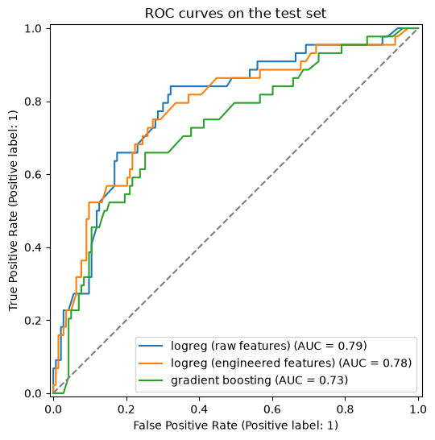

# Predicting blood donations

Predicts whether a blood donor will donate again on the next campus visit, comparing logistic regression and gradient boosting with cross-validation.



## Data

`datasets/transfusion.data`: the [Blood Transfusion Service Center dataset](https://archive.ics.uci.edu/ml/datasets/Blood+Transfusion+Service+Center) from UCI (748 donors).

## Key results

- `Monetary` is exactly `Frequency * 250`, so it is dropped as redundant.
- Logistic regression reaches a test ROC AUC of about 0.78 and beats gradient boosting (0.73).
- Recency is the main driver: the longer since the last donation, the less likely a donor is to return.

## Running the notebook

```bash
pip install -r requirements.txt
jupyter notebook notebook.ipynb
```

## License

The code is released under the [MIT License](LICENSE). Datasets keep the terms of their original sources, described above.
